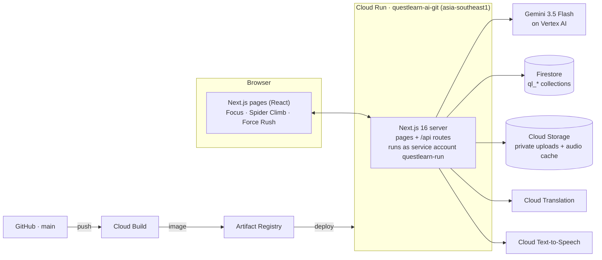
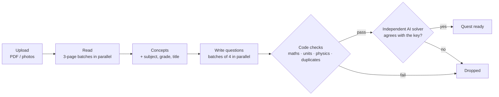

# QuestLearn AI

**An AI tutor that turns your own notes into a game that teaches you.** Photograph a handwritten chapter or upload a PDF. QuestLearn AI reads it, writes questions from it, checks every answer key, and lets you play the chapter as a game. When you get something wrong, it explains the specific mistake you made, in your language, and can read the explanation aloud.

**Live:** https://questlearn-ai-git-ompbxof3ra-as.a.run.app

Built on **Gemini on Vertex AI**, **Cloud Run**, **Cloud Storage**, **Cloud Text-to-Speech**, **Cloud Translation** and **Firestore**.

---

## 1. The problem

Students revise mostly from their own material: class notes, handwritten summaries, the chapter PDF their teacher shared. That material is passive. It can't test them, and it can't tell them why they keep getting something wrong.

- **Practice questions are generic.** Question banks and quiz apps don't match what *this* class covered or how *this* teacher explained it.
- **Feedback stops at "wrong".** A red cross doesn't show the misconception behind the answer, so the same mistake comes back in the exam.
- **AI chatbots aren't reliable tutors.** They can produce a quiz from notes, but nothing checks the answer keys, and a wrong key teaches the wrong thing with confidence.
- **Revision is a chore.** Re-reading notes is the least effective and least engaging way to study.
- **Language and access.** Many students in India learn best in Hindi, Tamil, Bengali or another home language, and some learn better by listening than reading.

**The challenge:** turn the content students already have into a personalised, engaging and *trustworthy* learning experience, in their own language.

## 2. The solution

QuestLearn AI turns a chapter into a **quest**: a checked, adaptive set of questions you can play as a game.

| Step | What the student sees | What the AI does |
|---|---|---|
| **1. Upload** | Photograph notes or add a PDF. Subject, grade and title are detected automatically. | Gemini reads handwriting, equations and diagrams, then pulls out the chapter's concepts, formulas, definitions and examples, with page references. |
| **2. Play** | Choose **Spider Climb** (each answer picks a web anchor), **Force Rush** (each answer opens an obstacle) or **Focus** (plain questions). | Questions are written from *your* notes, and every answer key is checked twice: by code and by an independent AI solver. |
| **3. Learn from mistakes** | A wrong answer opens a short lesson about *the option you picked*, then "Try a similar question" gives a fresh one on the same idea. | Gemini explains why that option was tempting, works through a different example, and writes a checked follow-up question. |
| **4. Know what to do next** | An end-of-run **report**: which concepts to learn, what went wrong, and concrete next steps citing pages in your notes. | Built only from your real wrong answers; nothing is invented. |
| **In any language** | Switch to हिन्दी, বাংলা, தமிழ், తెలుగు, मराठी, ગુજરાતી, ಕನ್ನಡ, മലയാളം, ਪੰਜਾਬੀ, Español, Français or العربية, and press **Read aloud**. | Cloud Translation and Cloud Text-to-Speech, run on demand and cached, so they add no time to building a quest. |

### What makes it different

- **Your material, not a generic bank.** Every question is grounded in the uploaded notes and cites the page it came from.
- **Checked AI, not trusted AI.**
  - Numerical answers are recalculated by code, with unit checks.
  - Physics answers are tested against conservation laws.
  - A second, independent Gemini call answers each question *without* the key, and if it disagrees, the question is dropped.
  - Every item is labelled with where it came from: *Sample*, *Generated from a template*, or *AI-written, checked*.
- **Personalised at the level of the mistake.** Lessons target the specific wrong option you picked, and difficulty adapts: two right in a row steps up, and repeated misses slow down and simplify.
- **Learning through play.** The same checked questions drive a real game, so revision feels like play rather than re-reading.
- **Built for India.** Nine Indian languages plus English, Spanish, French and Arabic, with read-aloud for accessibility.

### Suggested directions covered
**Personalized learning** (adaptive difficulty, targeted lessons, follow-ups, mastery), **content creation** (notes → questions, lessons, reports), **interactive experiences** (game modes) and **multilingual, audio experiences** (Translation and Text-to-Speech).

---

## 3. How AI makes the difference

AI isn't a feature added on top of QuestLearn; it does the work that makes it possible. Without it you'd need a teacher to read each student's notes, write questions about them, check the answer keys, diagnose every wrong answer and translate the lesson. With Gemini that takes about a minute per chapter, and every student gets it.

### What the AI does, and why it couldn't be done with rules

| AI capability | What Gemini does | Why rules, templates or plain OCR can't | Safeguard |
|---|---|---|---|
| **Reading messy notes** (multimodal) | Transcribes handwriting, printed text, equations (as LaTeX) and diagrams from photos and PDFs | OCR breaks on handwriting, equations and diagrams; it has no idea what a crossed-out line or a free-body diagram means | Marks unreadable parts `[illegible]` instead of guessing; rejects uploads that aren't study material or can't be read |
| **Understanding the chapter** | Builds a concept map with formulas, definitions, examples and page references; detects the subject, grade and title | Each chapter, teacher and handwriting style is different; no fixed parser can find "the ideas" in it | Separates concepts *found in your notes* from background it added; lists anything uncertain |
| **Writing good questions** | Writes conceptual, application, numerical and reasoning questions. Each wrong option is a *named misconception* with feedback. | Templates exist for only a few topics and can't write a question about *your* chapter; real distractors need to understand how students go wrong | Maths recalculated by code with units; physics invariants checked; duplicates removed; an independent solver must agree with the key |
| **Checking the AI with AI** | A second Gemini call answers every question *without seeing the key* | Only something that can solve the question can catch a wrong key in an arbitrary subject | If it disagrees, or finds the question ambiguous or factually wrong, the question is dropped |
| **Diagnosing your mistake** | Explains why the option *you* picked was tempting, then teaches the idea with a fresh worked example | A stored explanation explains the right answer, not *your* wrong one; it can't adapt when you keep missing the same idea | The correct answer is fixed before the model sees it, so it can't change the key; after repeated misses it switches to simpler language and an everyday analogy |
| **Re-testing the idea** | Writes a follow-up question on the same concept in a new context, with a distractor aimed at the same misconception | Re-asking the same question tests memory, not understanding | Same code checks and independent solver as every other question; template generators take over if AI fails |
| **Coaching** | An end-of-run report: the pattern behind your mistakes, the idea to learn, and next steps citing pages of your notes | Spotting the *pattern* across several different wrong answers takes understanding, not counting | Uses only your real wrong answers; concepts the model invents are discarded |
| **Your language, read aloud** | Cloud Translation and Cloud Text-to-Speech (Google's AI) in 13 languages, including 9 Indian ones | Hand-translating every generated question and lesson isn't possible | Maths is protected from translation and turned into words for speech; English never calls the API |

### Before and after

| | Revising from notes today | With QuestLearn AI |
|---|---|---|
| Practice | Generic question banks, or none for *your* notes | Questions written from your own chapter, with page references |
| Feedback | "Wrong. The answer is B." | Why *your* choice was tempting, the idea behind it, a worked example, and a fresh question to prove it's fixed |
| Difficulty | Same for everyone | Adapts to you, question by question |
| Next step | Re-read everything | A report naming the concepts to learn and what to do |
| Language | Mostly English | 13 languages, read aloud |
| Trust | AI quizzes with unchecked keys | Every key checked by code and by an independent AI; every item labelled with where it came from |

### Responsible AI
- **Never trusted blindly:** every AI-written question passes deterministic checks and an independent AI solver before a student sees it. Failures are dropped and counted, never shown.
- **Honest labels:** each question, lesson and report says whether it's *Sample*, *Generated from a template* or *AI-written, checked*. Nothing mocked is presented as AI output.
- **No invented content:**
  - Unreadable notes get a request for a clearer photo.
  - Lessons say when your notes don't support a confident answer.
  - The report only uses mistakes you actually made.
- **Fails safely:** if Gemini is slow or unavailable, the stored explanation, template follow-ups or a clear retry message take over, so the student isn't left stuck.
- **Age-appropriate and private:**
  - Prompts are written for students aged 14–18.
  - Students are anonymous guests, uploads are private, and they can delete their data.
  - Every AI call is logged with its outcome for review.

### AI as an engineered system

Each step uses the setting that fits its job: minimal thinking where speed matters and the facts are already fixed, full reasoning where correctness depends on it.

| Step | Model | Thinking | Typical time | Cached |
|---|---|---|---|---|
| Read notes (3-page batches in parallel) | Gemini 3.5 Flash | minimal | ~10 s | per upload |
| Extract concepts + subject/grade | Gemini 3.5 Flash | default | ~20 s | per upload |
| Write questions (batches of 4 in parallel) | Gemini 3.5 Flash | minimal | ~30 s with checks | per quest |
| Independent answer check | Gemini 3.5 Flash | default | ~10 s per batch | per quest |
| Lesson for a wrong answer | Gemini 3.5 Flash | minimal | ~5 s (stored lesson shows instantly) | per attempt |
| Follow-up question | Gemini 3.5 Flash | default | ~20–30 s | per mistake |
| End-of-run report | Gemini 3.5 Flash | minimal | ~5 s | per run |
| Translation / read aloud | Cloud Translation / Text-to-Speech | — | ~0.6 s / ~0.4 s (instant when cached) | per text |

Every call returns structured JSON checked against a schema. A slow request gets an automatic backup, and failures come back as clear messages. That work took a 3-photo chapter with 10 questions from about **6 minutes to about 1 minute**.

---

## 4. Architecture



QuestLearn is **one Next.js 16 application** that serves both the pages and the API. There's no separate backend service.

### From notes to a quest (`src/lib/services/materials.ts`)



| Stage | What happens | Typical time |
|---|---|---|
| Upload | File types checked from their actual bytes; size, page and dimension limits enforced; images oriented and resized; saved to a private bucket | 1–3 s |
| Read | Long PDFs split into 3-page pieces, images grouped 3 at a time, all transcribed in parallel by Gemini at minimal thinking | ~10 s |
| Concepts | Chapter outline with page references; the subject, grade and title are detected | ~20 s |
| Questions | Written in parallel batches of 4, each batch checked by code and by the independent solver as soon as it's done | ~30 s |

Each stage saves a checkpoint, so **Retry** resumes where it stopped and never creates a duplicate quest. The create screen shows live progress, for example "2 of 4 batches checked".

### Playing and learning (`src/lib/services/play.ts`, `tutor.ts`, `report.ts`)
- **Marking on the server:** the browser never receives the answer key before you answer, and each question can be answered once per run.
- **Adaptive difficulty:** the next question gets harder after two correct answers in a row, and easier after repeated misses.
- **Mastery:** each concept has a transparent score that weights recent results and counts a fixed mistake extra. One lucky answer is never "mastered".
- **Lessons:** the stored explanation appears instantly; the AI lesson aimed at your exact answer replaces it a few seconds later. Both are cached per attempt.
- **Follow-up questions** go through the same code checks and independent solver. If AI is unavailable, deterministic template generators take over.
- **End-of-run report:** built from the run's real wrong answers, misconception labels and notes excerpts, and cached per run.

### How Gemini is called (`src/lib/ai/client.ts`)
Every model call goes through one function, `generateJson`, which:
- **Asks for JSON and validates it** against a zod schema, with one automatic correction attempt. Vertex's built-in schema enforcement isn't used: in testing it randomly stalled about a third of requests.
- **Sends a backup request** if a call runs well past its normal time, and uses whichever answers first.
- **Retries temporary errors** and turns provider failures into clear messages (busy, quota used up, billing disabled).
- **Logs every call** (step, model, duration, outcome) to Firestore `ql_audit`.

Latency was cut from about 6 minutes to about 1 minute for a 3-photo chapter with 10 questions, mainly by removing the stalling schema mode, running batches in parallel, using minimal thinking where reasoning adds nothing, and adding the backup requests.

### Languages and audio (`src/lib/services/language.ts`, `src/lib/language/*`)
- **Translation on demand:** text is translated when it's shown, with maths protected, batched into one request per screen and cached per text in Firestore. In testing that took ~0.6–1.4 s the first time and ~60 ms after; English makes no call.
- **Text-to-Speech:** maths is turned into words first ("½mv²" becomes "1 over 2 m v squared"). For each language the server picks the fastest good voice (Neural2, then Wavenet, then Standard), and audio is cached in Cloud Storage. Measured at about 0.4 s per passage.

### Data
- **Firestore** (`ql_*` collections):
  - **Content:** `materials`, `concepts`, `questions`, `quests`.
  - **Play:** `sessions`, `attempts`, `mastery`.
  - **Other:** `users`, `assets` (cached lessons and reports), `translations`, `audit`.
- **Cloud Storage:** `users/{uid}/materials/{id}/…` for uploads and `cache/tts/…` for audio. The bucket is private and deletes files after 180 days.
- **Identity:** an anonymous guest ID in an httpOnly cookie. No name or email is collected, and students can delete their own data.

### Google Cloud technologies

| Technology | Used for |
|---|---|
| **Gemini on Vertex AI** (`gemini-3.5-flash`) | Reading notes, concept extraction, question writing, independent answer checking, lessons, follow-ups, reports |
| **Cloud Run** | Hosting the app (pages + API) |
| **Cloud Storage** | Private uploads, cached audio |
| **Cloud Text-to-Speech** | Read aloud in 13 languages |
| **Cloud Translation** | Questions, lessons and reports in 13 languages |
| **Firestore** | All records, translation cache, AI audit log |
| **Cloud Build + Artifact Registry** | Continuous deployment from GitHub |

### Tech stack
Next.js 16 (App Router), React 19, TypeScript, Tailwind CSS v4, Motion, KaTeX (maths), Recharts, zod, `@google/genai`, `sharp` and `pdf-lib` (file handling), Vitest.

---

## 5. Run it locally

Requirements: Node.js 22+ and npm.

```bash
npm install
npm run dev          # http://localhost:3000
```

**Without any settings it runs in demo mode:**
- **Sample chapter:** the Physics · Collisions quest is fully playable.
- **Lessons and follow-ups:** use prepared, hand-checked content and template-generated questions.
- **Uploads:** stored locally; analysis explains that AI isn't configured.
- **Labels:** nothing mocked is presented as AI output.

To use Google Cloud, create `.env.local`; see [.env.example](.env.example).

| Variable | Purpose |
|---|---|
| `GOOGLE_GENAI_USE_VERTEXAI=true` | Use Gemini on Vertex AI |
| `GOOGLE_CLOUD_PROJECT` | Your project ID |
| `GOOGLE_CLOUD_LOCATION=us` | Vertex AI location (the `global` endpoint returned 404 in testing) |
| `GEMINI_MODEL` | Default `gemini-3.5-flash` |
| `QL_DB=firestore` | Use Firestore instead of the local JSON store |
| `GCS_BUCKET` | Private bucket for uploads and the audio cache |
| `QL_AI_CONSTRAINED_JSON=true` | Optional: use Vertex's built-in schema enforcement (off by default; it stalled requests) |
| `QL_ENABLE_VIDEO`, `VEO_MODEL` | Optional Veo video lessons |

Locally, credentials come from `gcloud auth application-default login`; on Cloud Run, from the service account. Secrets never reach the browser.

**Google Cloud APIs to enable:** Vertex AI, Firestore, Cloud Storage, Cloud Run, Cloud Build, Artifact Registry, Text-to-Speech and Cloud Translation.

## 6. Deploy

**Continuous deployment (current setup).** Every push to `main` on GitHub starts a Cloud Build trigger. It builds the [Dockerfile](Dockerfile) (a Next.js standalone server on Node 22), pushes the image to Artifact Registry and updates the Cloud Run service. If a build fails, the previous version keeps serving.

**One-command deploy** (sets up the service account, permissions, bucket and Firestore, then deploys from source):

```bash
PROJECT_ID=your-project ./scripts/deploy-cloud-run.sh
```

The Cloud Run service account needs these roles:
- Vertex AI User
- Cloud Datastore User
- Cloud Translation User
- Storage Object Admin on the uploads bucket

The default compute service account (which runs the builds) needs:
- Cloud Run Builder
- Developer Connect Read Token Accessor (for GitHub deploys)

## 7. Testing and quality

```bash
npm test            # Vitest: 531 tests
npm run typecheck
npm run lint
npm run eval        # quality report → eval/results/latest.{json,md}
```

The tests cover:
- **Answer checking:** validation, units and physics invariants, every sample question, and the template generators across many random seeds.
- **File handling:** valid and broken uploads.
- **The learning loop:** adaptive difficulty, lessons, follow-ups, mastery, and answers that can't be counted twice.
- **The AI pipeline with a mocked model:** wrong keys, unit errors and solver disagreement are rejected; failed runs resume without duplicates; unreadable uploads are refused; and the tutor and report fall back honestly.
- **Supporting logic:** parallel batching and reading, backup requests, subject and grade detection, and turning maths into speech.

## 8. Project structure

| Path | What's there |
|---|---|
| `src/app/*` | Pages (`/`, `/create`, `/dashboard`, `/quest/[id]`, `/progress`, `/learn/...`) and `/api` routes |
| `src/lib/services/*` | Business logic: materials pipeline, play, tutor, report, language |
| `src/lib/ai/*` | Gemini client, prompts, schemas and workflows |
| `src/lib/validation/*` | Answer-key, unit and physics checks |
| `src/lib/engine/*` | Mastery, scoring, adaptive difficulty |
| `src/lib/db/*`, `src/lib/storage/*` | Firestore or local JSON; Cloud Storage or local disk |
| `src/components/games/*` | Spider Climb and Force Rush (canvas engines + game panels) |
| `docs/design-system.md` | Design rules |

## 9. Known limitations

- **Speed varies:** Gemini latency varies, so building a quest takes about a minute and occasionally longer.
- **Partial translation:** learning content follows the language picker, but menus and Force Rush's own panel stay in English, and Arabic isn't laid out right-to-left yet.
- **No teacher view yet.** Next step: a class-insights dashboard on BigQuery.
- **Guest accounts only:** progress is tied to the browser's guest cookie.
- **Not validated with students:** mastery is a practice guide, not a validated assessment score.
